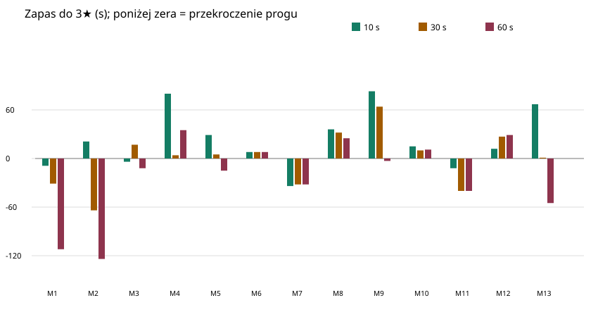

# Krzywa trudności misji — 6 listopada 2026

Stan kodu: `b020c577debddb24cdacba06b11dbbf005f7c0d1`. Pomiar `node --import tsx tools/balance-night6.ts --no-search`; uruchomienie przez `npx tsx` nie działało w tym środowisku ze względu na blokadę IPC. To samo narzędzie i argumenty, inny sposób załadowania TypeScript.

Strategia `eye+`: bot co 10, 30 lub 60 s sprawdza kartę i realizuje sugerowaną naprawę, uwzględniając tekstowe wskazówki. Wartości to zapas sekund do progów 3★/2★; ujemny oznacza przekroczenie progu, niekoniecznie przegraną misję. Wynik jest pomiarem deterministycznego bota, nie ludzi.

| Misja | 10 s: 3★ / 2★ | 30 s: 3★ / 2★ | 60 s: 3★ / 2★ |
|---|---:|---:|---:|
| M1 | −9 / +81 | −31 / +59 | −112 / −22 |
| M2 | +21 / +81 | −64 / −4 | −124 / −64 |
| M3 | −4 / +101 | +17 / +122 | −12 / +93 |
| M4 | +80 / +230 | +4 / +154 | +35 / +185 |
| M5 | +29 / +77 | +5 / +53 | −15 / +33 |
| M6 | +8 / +32 | +8 / +32 | +8 / +32 |
| M7 | −34 / +86 | −32 / +88 | −32 / +88 |
| M8 | +36 / +81 | +32 / +77 | +25 / +70 |
| M9 | +83 / +179 | +64 / +160 | −3 / +93 |
| M10 | +15 / +75 | +10 / +70 | +11 / +71 |
| M11 | −12 / +42 | −40 / +14 | −40 / +14 |
| M12 | +12 / +78 | +27 / +93 | +29 / +95 |
| M13 | +67 / +217 | +1 / +151 | −55 / +95 |
| M14 | brak danych | brak danych | brak danych |
| M15 | brak danych | brak danych | brak danych |

- **M1 i M2:** start jest wymagający: dla 30 s odpowiednio −31 s i −64 s do 3★; M2 przy 30 s i 60 s przekracza również próg 2★. To silny skok na początku.
- **M7 i M11:** bot we wszystkich trzech wariantach nie osiąga 3★ (M7: −32 do −34 s; M11: −12 do −40 s). Warto sprawdzić czy wskazówki i progi odpowiadają zamierzonemu poziomowi.
- **M8–M10 i M12:** w większości łatwiejsze dla bota niż wcześniejsze M7; M8 i M10 uzyskują 3★ we wszystkich badanych odstępach. M13 ma skrajnie mały zapas 1 s przy 30 s i traci 3★ przy 60 s.
- Wyniki nie muszą być monotoniczne: częstszy przegląd zmienia kolejność decyzji i zużycie zasobów. Nie należy interpretować tych liczb jako czasu reakcji ani wyników rzeczywistych graczy.

**Brak M14–M15:** domyślne wywołanie pomija je, ponieważ nie ma ich w `MISSIONS`; jawne podanie `m14 m15` kończy się `TypeError` przy odczycie `star3Min`. Definicje znajdują się w `src/sim/proposals/missions-14-15.ts`, ale nie są aktywnymi misjami. Nie wyliczono wartości z fikcyjnych lub nieporównywalnych danych.
